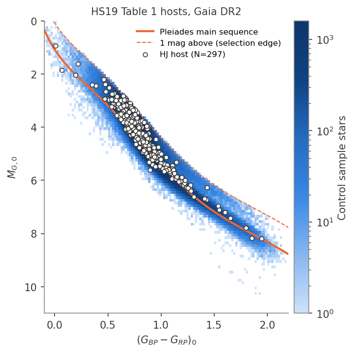
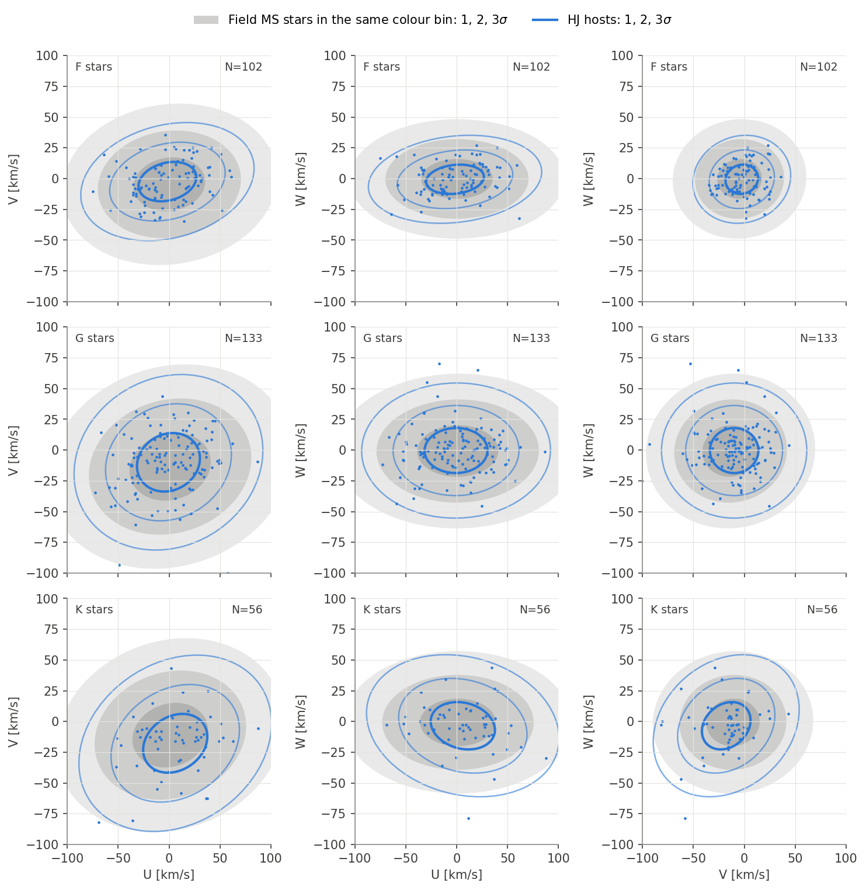
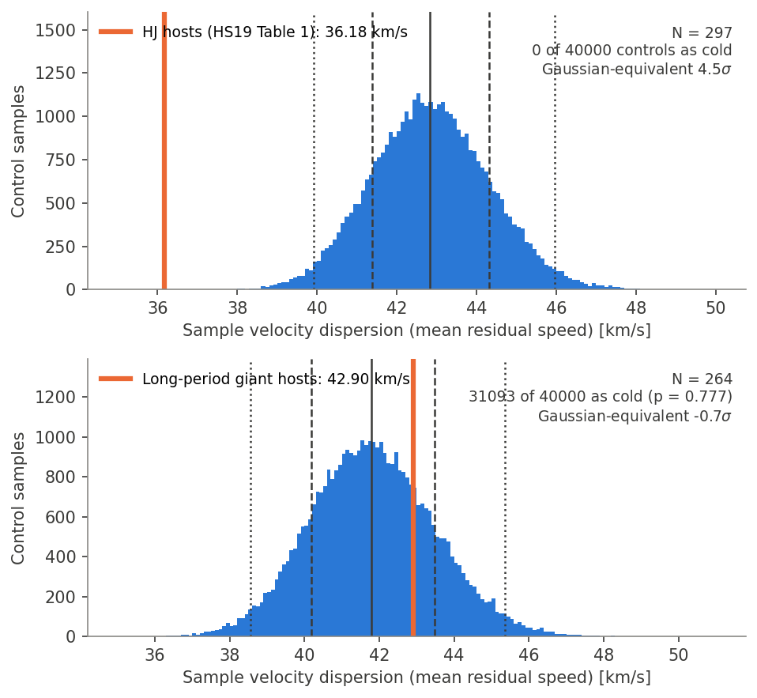
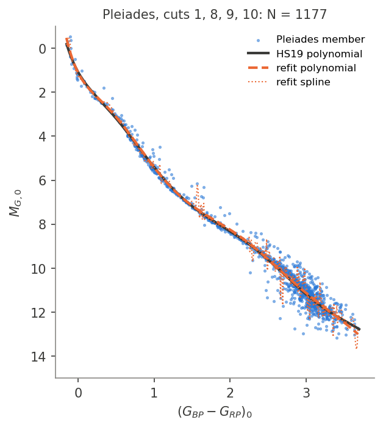
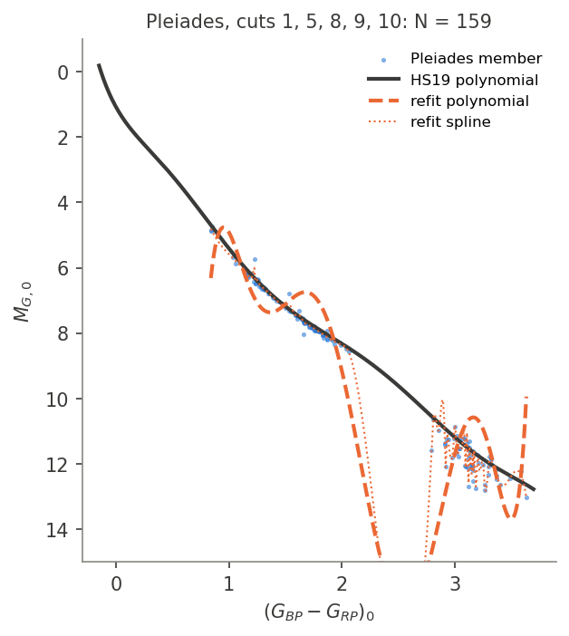

# Phase 1 reproduction of Hamer & Schlaufman (2019): Checkpoint 1

**Status:** approved by the user on 2026-10-30. Decisions are in DECISIONS.md
under "Checkpoint 1 decisions".

Run: `phase1_dr2` (Gaia DR2, 2026-10-30). Config: `config.yaml`, seed 20191021.
Every judgment call is logged in `DECISIONS.md` (codes such as D14 and A7 refer to it).
Outputs are in `data/processed/phase1_dr2/` and figures in `figures/phase1_dr2/`.

## Conclusion

**The main result reproduces.**

- **HJ hosts are colder.** The 297 main-sequence HJ hosts from HS19's Table 1
  have a velocity dispersion of **36.18 km/s**; HS19 show 36.11 km/s. **None of
  40,000** colour- and z-matched control samples is that cold. The controls
  have a median of 42.82 km/s and a 2–98 % range of 39.9–46.0 km/s. HS19 say
  "less than one in 40,000 (or more than 4σ)". The Gaussian-equivalent offset
  is 4.5σ (HS19's own figure gives about 5.2σ).
- **Long-period hosts are not.** The 264 long-period giant-planet hosts are
  consistent with the field: 42.90 km/s against a control median of 41.78,
  with 78 % of controls as cold or colder.
- **Robust to the reasonable alternatives.** Every sensitivity test keeps both
  conclusions. HJ hosts sit 3.3–5.3σ below the control median, with at most
  1 of 5,000 controls as cold. Long-period hosts always give p = 0.27–0.85.

**Where we differ from the paper:**

- **Sample sizes are smaller:** 297 vs 338 HJ hosts, 376,791 vs 385,036
  field stars, 264 vs 367 long-period hosts. The causes are known and
  located below.
- **Our control distribution sits about 0.5 km/s lower** than HS19's.
- **HS19 used the average residual speed, not the RMS.** The spec's formula
  is the RMS, but HS19's eq. 1 is the average distance from the sample mean
  in UVW. That statistic reproduces their 36.1 km/s; the RMS gives 40.5.
  It is our primary statistic (D14), and the RMS gives the same conclusions.

## 1. Pipeline summary

| Step | Implementation | Ref. |
|---|---|---|
| HJ hosts | HS19 Table 1 (338 hosts, machine-readable table); archive list (P < 10 d, M sin i > 0.1 MJup, disc. ≤ 2019) run alongside | A3, D4, D5 |
| Long-period hosts | P > 10 d, M sin i > 0.1 MJup, disc. ≤ 2019, HJ hosts included | D7 |
| Gaia IDs | SIMBAD (Harvard mirror), archive `gaia_dr2_id` as fallback | D6b |
| Gaia DR2 data | ARI Heidelberg TAP (bit-identical to ESA, validated); field in 192 source_id ranges | A6–A8 |
| Field | 5-parameter solution + RV, cuts 1–10; planet hosts removed | D17 |
| Cuts 4, 8 | Lindegren et al. (2018) C.1/C.2 (the paper's typos corrected) | D1, D2 |
| Distances | Bailer-Jones et al. (2018) `r_est` | D16 |
| Extinction | STILISM cube v4.1 (2018-03-19), the map STILISM served during HS19's work: the Lallement+2018 map built on Capitanio+2017 (HS19 cite Capitanio+2017); line-of-sight integration, CV18 mean coefficients | A1, D9, D9b |
| Main sequence | Published 8th-order Pleiades polynomial; keep M_G0 > MS − 1 mag | D8 |
| UVW | astropy GalacticLSR, Schönrich+2010 solar motion; z with R0 = 8.3 kpc, z_sun = 27 pc | D11, D15 |
| Dispersion | (1/N) Σ √[(U−Ū)² + (V−V̄)² + (W−W̄)²] (HS19 eq. 1) | D14 |
| Monte Carlo | z-matched subsample by histogram thinning (50 pc bins), one control star per host within 0.025 mag in (BP−RP)₀, no star reused, 40,000 iterations | D12, D13, D13b |

## 2. Counts, step by step

Each number is how many survive that step and every step above it.
Saved as `data/processed/phase1_dr2/count_table.csv`.

| Step | Field | HJ hosts (Table 1) | HJ hosts (archive ≤ 2019) | Long-period hosts |
|---|---|---|---|---|
| Downloaded with pre-filter¹ / hosts listed | 1,372,060 | 338 | 505 | 575 |
| Gaia DR2 row found | – | 338 | 500 | 562 |
| Cut 1: parallax_over_error > 10 | 1,372,060 | 338 | 487 | 556 |
| Cut 2: mean_varpi_factor_al range | 1,372,060 | 338 | 485 | 551 |
| Cut 3: visibility_periods_used > 8 | 1,372,060 | 338 | 458 | 512 |
| Cut 4: unit weight error (C.1) | 1,372,060 | 338 | 457 | 510 |
| Cuts 5–10 (field only) | 1,372,060 | – | – | – |
| Excluding planet hosts | 1,371,976 | – | – | – |
| Distance, extinction corrected | 1,371,976 | 338 | 457 | 510 |
| **Main-sequence cut** | **376,791** | **322** | 402 | **322** |
| **Has an RV** (UVW computable) | – | **297** | 360 | **264** |
| **Final** | **376,791** | **297** | **360** | **264** |
| Paper | 385,036 | 338 | – | 367 |
| F / G / K | 89,496 / 179,780 / 103,636 | 102 / 133 / 56 | 122 / 153 / 75 | 45 / 155 / 56 |
| Paper F / G / K | – | 119 / 146 / 66 | – | – |
| Outside the F/G/K bins | 3,879 | 6 | 10 | 8 |

¹ The server applies the RV requirement, a parallax, and cuts 1–3, 5–7, 9
and 10 exactly, plus cut 8 with a looser bound. Those field rows therefore show
no further loss. Cuts 4 and 8 also remove nothing locally. The largest unit
weight error is 0.40× the C.1 threshold, since cut 5 (gof < 3) already
implies a small one. The smallest excess factor is 1.15, well above C.2's
1 + 0.015 c². The paper's literal (typo) cut 4 would remove 631 field stars,
but 173 of the 338 Table 1 hosts (only 165 pass). Since HS19 kept all 338,
they cannot have applied it.

**Where the differences arise**

| Sample | Ours vs paper | Step | Likely cause |
|---|---|---|---|
| Field | 376,791 vs 385,036 (−2.1 %) | Main-sequence cut | Small differences at the MS edge (extinction, distances, or using the spline vs the polynomial). Shifting the threshold by +0.05 mag or using our refit polynomial (382,499, −0.7 %) closes most of the gap (§4.3). |
| HJ hosts | 297 vs 338 (−41) | Main-sequence cut (−16) | 13 lie within 0.36 mag of the edge; CoRoT-17/-23/-28 have STILISM E(B−V) = 0.44–0.75. Nothing tried recovers them (D8c). |
| | | RV (−25) | No archive systemic RV today and no DR2 RV (D6c). The archive has none in any of its 439 `stellarhosts` parameter sets either. These hosts are fainter (median G 14.0 vs 11.9) and farther away (530 vs 294 pc), with similar colours. |
| HJ F/G/K | −17 / −13 / −10 | Same as above | The losses are spread across the bins. |
| Long-period hosts | 264 vs 367 (−103) | Main-sequence cut (−188 of 510) | The MS cut removes 37 % of long-period hosts (5 % of HJ hosts). Many RV-survey hosts are subgiants, so this count is very sensitive to the MS edge and to the 2019 host list. |
| | | RV (−58) | Faint transit/microlensing hosts without an RV. |
| | | List | The 2019 archive cannot be reconstructed. Variant choice (D7): HJ hosts included (264), excluded (242), mass upper limits dropped (243), disc. ≤ 2018 (232). |

**Table 1 vs the archive list.** 334 of the 338 Table 1 hosts are on today's
archive HJ list once upper-limit masses are kept, as HS19 evidently did (D4).
The other 4 (Kepler-23, -28, -54, -57) now have measured masses below
0.1 MJup, and all 4 also lack an RV, so the final samples are identical
(§4.4). HS19's Table 1 lists the wrong star for HATS-67. We keep it in the
faithful run (D6b).

## 3. Main results (40,000 iterations)

Paper values come from the vector Fig. 4 in the arXiv source (A9); HS19 give
no numbers in the text. "Fraction as cold" is the fraction of control samples
with a dispersion at or below the hosts'. The Gaussian-equivalent significance
is (control median − host) / (control standard deviation). It assumes Gaussian
tails, so treat it as a translation of the offset, not an exact probability.
For the paper, the standard deviation is (p84 − p16)/2.

| Sample | N | Host dispersion | Controls 2 / 16 / 50 / 84 / 98 % | Control SD | Fraction as cold | Gaussian-equivalent |
|---|---|---|---|---|---|---|
| **HJ hosts (Table 1)**, ours | 297 | **36.18** | 39.92 / 41.38 / 42.82 / 44.32 / 45.97 | 1.48 | **0 / 40,000** (< 2.5×10⁻⁵) | **4.5σ** |
| HJ hosts, paper | 338 | 36.11 | 40.55 / 41.97 / 43.33 / 44.77 / 46.43 | ≈ 1.40 | < 1 / 40,000 | ≈ 5.2σ ("> 4σ" in text) |
| HJ hosts (archive ≤ 2019), ours | 360 | 36.14 | 40.16 / 41.49 / 42.81 / 44.16 / 45.65 | 1.35 | 0 / 40,000 | 5.0σ |
| **Long-period hosts**, ours | 264 | **42.90** | 38.55 / 40.19 / 41.78 / 43.47 / 45.37 | 1.66 | **0.777** | −0.7σ |
| Long-period hosts, paper | 367 | 43.10 | 40.67 / 42.08 / 43.41 / 44.76 / 46.28 | ≈ 1.34 | "fully consistent" (≈ 0.4 from the figure) | ≈ 0.2σ |

All dispersions are in km/s. For scale, 0 of 40,000 corresponds to an
empirical one-sided bound of p < 2.5×10⁻⁵, i.e. > 4.06σ for a Gaussian.

- **The HJ host value matches the paper to 0.07 km/s.** Our controls are about
  0.5 km/s colder than HS19's (median 42.82 vs 43.33), and slightly wider
  because our sample is smaller: the width scales as √(338/297) ≈ 1.07, and
  1.40 × 1.07 ≈ 1.49, close to our 1.48. Together these explain why our
  Gaussian-equivalent significance (4.5σ) is lower than the paper's
  (about 5.2σ). The 0.5 km/s shift probably reflects the different field
  sample at the MS edge and the missing hosts (§2).
- **Long-period hosts:** HS19's host value lies slightly below their control
  median, ours slightly above (+1.1 km/s). Both are well inside the control
  distribution.
- **RMS statistic, for reference:** HJ hosts 40.50 km/s against controls
  45.5–55.2 (2–98 %), 0 of 40,000 as cold. Long-period hosts 48.59, p = 0.49.
- **Unmatched hosts** (D13b): in an iteration where a host had no field star
  within 0.025 mag of its colour, both the host and the control dispersion use
  only the matched hosts.
  - **HJ hosts (Table 1):** KELT-9 was unmatched in 22 % of iterations and
    KELT-20 in 6 % (both A stars, (BP−RP)₀ < 0.07). KELT-21 and HATS-70 were
    unmatched in under 0.1 %. The mean is 0.28 hosts per iteration.
  - **HJ hosts (archive list):** Kepler-42, an M dwarf with (BP−RP)₀ = 2.64,
    is never matched.
  - **Long-period hosts:** five M dwarfs are never matched (GJ 433, 832, 1148,
    876, 317). No field star with a DR2 RV is that red.
- **Runtime:** 2.3 ms per iteration; the 40,000-iteration primary runs took
  about 95 s per sample. The Monte Carlo is saved in 5,000-iteration chunks,
  so an interrupted run resumes where it stopped (D19).

## 4. Sensitivity tests

5,000 iterations each (`results_sensitivity.csv`). The HJ rows use the Table 1
hosts.

### 4.1 z-matching and control construction

| Variant | HJ disp. / ctrl median | HJ fraction as cold | HJ Gauss. | LP disp. / ctrl median | LP fraction as cold |
|---|---|---|---|---|---|
| Primary (50 pc bins, thinning) | 36.18 / 42.81 | 0 | 4.5σ | 42.90 / 41.82 | 0.78 |
| 25 pc bins | 36.18 / 42.80 | 0 | 4.5σ | 42.90 / 41.80 | 0.78 |
| 100 pc bins | 36.18 / 42.75 | 0 | 4.4σ | 42.90 / 42.09 | 0.73 |
| 5 host-quantile bins | 36.18 / 42.64 | 0 | 4.4σ | 42.90 / 42.15 | 0.71 |
| 10 host-quantile bins | 36.18 / 42.77 | 0 | 4.4σ | 42.90 / 41.79 | 0.77 |
| 20 host-quantile bins | 36.18 / 42.74 | 0 | 4.4σ | 42.90 / 41.71 | 0.80 |
| Weighted resampling instead of thinning | 36.18 / 42.78 | 0 | 4.5σ | 42.90 / 41.77 | 0.78 |
| No z-matching | 36.18 / 42.16 | 0 | 4.1σ | 42.90 / 44.04 | 0.27 |
| Controls with replacement | 36.18 / 42.78 | 0 | 4.4σ | 42.90 / 41.80 | 0.78 |
| Hosts with no field match excluded (1 archive HJ, 5 LP) | 36.18 / 42.81 | 0 | 4.5σ | 43.08 / 41.82 | 0.77 |

The binning choice moves the control median by at most 0.2 km/s. Turning off
z-matching changes the long-period result more than the HJ result: the
long-period hosts lie close to the midplane (median |z| 30 pc, against 99 pc
for the field and 127 pc for HJ hosts), so an unmatched field is hotter.

### 4.2 Main-sequence relation and threshold

Keep M_G0 > MS − (1 + shift). HJ = Table 1 hosts.

| Variant | Field N | HJ N | HJ disp. / ctrl median | HJ fraction as cold | HJ Gauss. | LP N | LP fraction as cold |
|---|---|---|---|---|---|---|---|
| shift −0.3 | 326,350 | 262 | 35.95 / 42.74 | 0 | 4.3σ | 232 | 0.76 |
| shift −0.2 | 344,266 | 276 | 35.79 / 42.65 | 0 | 4.4σ | 247 | 0.79 |
| shift −0.1 | 361,179 | 290 | 35.98 / 42.76 | 0 | 4.5σ | 255 | 0.78 |
| **published polynomial, 1 mag** | **376,791** | **297** | 36.18 / 42.82 | 0 | 4.5σ | 264 | 0.78 |
| shift +0.1 | 391,515 | 306 | 36.05 / 42.92 | 0 | 4.8σ | 274 | 0.75 |
| shift +0.2 | 405,722 | 308 | 36.04 / 42.93 | 0 | 4.8σ | 280 | 0.70 |
| shift +0.3 | 419,157 | 309 | 35.97 / 42.96 | 0 | 4.9σ | 287 | 0.72 |
| our Pleiades refit polynomial | 382,499 | 304 | 36.09 / 42.78 | 0 | 4.6σ | 268 | 0.75 |
| Paper | 385,036 | 338 | 36.11 / 43.33 | < 1/40,000 | ≈ 5.2σ | 367 | consistent |

**No shift brings both counts close to the paper's.**
- **Field:** the paper's 385,036 corresponds to a shift of about +0.05 mag.
  Our own refit polynomial (D10; spline → 8th-order polynomial; max
  difference from the published one 0.07 mag) gives 382,499 (−0.7 %).
- **HJ hosts:** the count rises only to 309 even at +0.3. The ceiling is the
  25 hosts without an RV: 338 − 25 = 313 is the most possible with today's
  archive.
- **Results:** the dispersions and significances barely change with the
  threshold (HJ 35.8–36.2 km/s, 4.3–4.9σ).

### 4.3 Samples, cuts and RVs

| Variant | Field N | HJ N | HJ disp. / ctrl median | HJ fraction as cold | HJ Gauss. | LP N | LP disp. / ctrl median | LP fraction as cold |
|---|---|---|---|---|---|---|---|---|
| Primary | 376,791 | 297 | 36.18 / 42.82 | 0 | 4.5σ | 264 | 42.90 / 41.78 | 0.78 |
| Table 1 ∩ archive list (334 listed) | 376,791 | 297 | 36.18 / 42.81 | 0 | 4.5σ | – | – | – |
| Archive HJ list instead of Table 1 | 376,791 | 360 | 36.14 / 42.81 | 0 | 5.0σ | – | – | – |
| DR3 RV for hosts without one | 376,791 | 316 | 35.70 / 42.84 | 0 | 5.1σ | 292 | 41.98 / 41.86 | 0.54 |
| Cut 4 as printed (typo) | 376,490 | 136 | 37.58 / 45.06 | 1 / 5,000 | 3.3σ | 50 | 42.08 / 42.66 | 0.44 |
| Cut 8 with 0.0015 (typo) | 376,791 | 297 | 36.18 / 42.81 | 0 | 4.5σ | 264 | 42.90 / 41.82 | 0.78 |
| Long-period without HJ hosts | 376,791 | 297 | (unchanged) | 0 | 4.5σ | 242 | 43.25 / 41.61 | 0.85 |
| Heliocentric z (d sin b) | 376,791 | 297 | 36.18 / 42.76 | 0 | 4.4σ | 264 | 42.90 / 41.83 | 0.77 |
| disc. year ≤ 2018 | 376,794 | 297 | 36.18 / 42.83 | 0 | 4.4σ | 254 | 42.51 / 41.75 | 0.70 |
| Mass upper limits dropped | 376,792 | 297 | 36.18 / 42.83 | 0 | 4.5σ | 255 | 43.18 / 41.81 | 0.81 |

- **Table 1 ∩ archive list:** the requested 334-host subset gives exactly the
  primary sample. The 4 non-overlapping hosts all lack an RV.
- **DR3 RV fill:** recovers 19 of the 25 HJ hosts without an RV. The HJ hosts
  get slightly colder (35.70), which strengthens the result. This mixes data
  releases, so it stays a sensitivity test (D6c).
- **Cut 4 as printed:** only 165 of the 338 Table 1 hosts pass cuts 1–4 (136
  after the MS and RV steps). The HJ result survives even then (1 of 5,000
  controls as cold).

## 5. Figures

| | |
|---|---|
| Fig. 1, Pleiades main sequence (members, published polynomial, our refit) | `figures/phase1_dr2/fig1_pleiades.png` |
| Fig. 2, CMD of field and Table 1 HJ hosts, with the MS and the 1 mag selection edge | `figures/phase1_dr2/fig2_cmd_hj_table1.png` (archive list: `fig2_cmd_hj_archive.png`) |
| Fig. 3, UVW 1/2/3σ ellipses by F/G/K, field (grey) vs HJ hosts (blue) | `figures/phase1_dr2/fig3_uvw_hj_table1.png` |
| Fig. 4, Monte Carlo histograms, HJ (top) and long-period (bottom) | `figures/phase1_dr2/fig4_mc.png` (archive list: `fig4_mc_hj_archive.png`) |

The CMD confirms the sign of the MS cut: the dashed line is 1 mag brighter
than the MS, and every host lies below it. In Fig. 3 the hosts' ellipses are
generally smaller than the field's in all three colour bins, as in HS19.

## 5b. Pleiades main sequence: cut set used vs printed

Regenerate with `python -m src.pleiades`.

| Cut set | Members kept | (BP−RP)₀ range | Refit vs published polynomial (max / RMS) |
|---|---|---|---|
| 1, 8, 9, 10 (used) | 1,177 (after removing EGGR 25) | −0.15 – 3.69 | 0.074 / 0.046 mag over 0.44–2.02 |
| 1, 5, 8, 9, 10 (as printed) | 159 | 0.84 – 3.64 | 1.62 / 0.58 mag over 0.84–2.02; unconstrained bluer than 0.84 |

| Cuts 1, 8, 9, 10 (used) | Cuts 1, 5, 8, 9, 10 (as printed) |
|---|---|
|  |  |

With the printed cut 5 no Pleiades member is bluer than (BP−RP)₀ = 0.84, so
the F-star main sequence cannot be fitted at all. There is also a gap at
2.1–2.8, and the spline + 8th-order polynomial oscillates. With cut 5 dropped,
our refit reproduces HS19's published polynomial to 0.07 mag, and the
membership spans the same colour range as their Fig. 1. This is why we
conclude HS19 did not effectively apply cut 5 to the Pleiades (D10b).

## 6. Discrepancies and likely causes (summary)

1. **Sample sizes**
   - **HJ hosts, −41:** 25 hosts have no RV in today's archive; HS19's 2019
     archive had one (D6c). 16 fail the MS cut, mostly marginally, plus
     three high-extinction CoRoT stars (D8c).
   - **Field, −2.1 %:** the MS edge. The refit polynomial closes it to
     −0.7 %, a hint that HS19 cut on the spline (as the Fig. 1 caption
     says), not on the published polynomial.
   - **Long-period, −28 %:** the MS cut on a subgiant-rich sample, missing
     RVs, and a different 2019 host list (D7).
2. **Control distribution about 0.5 km/s colder than HS19's**, together with a
   smaller host sample, gives 4.5σ vs about 5.2σ. The conclusion is unchanged.
   The likely source is the field composition at the MS edge (item 1).
3. **Statistic:** the paper's eq. 1 (average residual speed), not the RMS
   (D14). Confirmed by the 36.18 vs 36.11 km/s match and by the TeX source.
4. **Typos in the paper:** cuts 4 and 8 follow Lindegren et al. (2018) (D1, D2).
   The printed cut 4 would have removed 173 of the 338 Table 1 hosts, which
   HS19 clearly kept.
5. **Data access** (no effect on results):
   - The original STILISM site is gone; the identical 2018 cube came from
     the Wayback Machine (A1).
   - Gaia data come from ARI Heidelberg, validated bit-for-bit against ESA
     (A6–A8).
   - An early ESA download had silently truncated chunks. It was replaced,
     and every ARI range was verified by COUNT(*) (A5, A7).

## 7. Open points for review

- **Primary samples:** HJ = Table 1 (297 after cuts; RV from the archive or
  DR2 only); long-period = HJ hosts included (264). The DR3 RV fill and the
  archive HJ list are reported as sensitivity tests. Should either become
  primary for Phase 2?
- **MS relation:** our refit polynomial matches the paper's field count better
  (−0.7 % vs −2.1 %). Phase 1 keeps the published polynomial because the
  paper gives it explicitly.
- **Pleiades cut set:** we applied cuts 1, 8, 9, 10, not the printed 1, 5, 8–10
  (cut 5 removes 88 % of the members and the white dwarf they say they removed
  by hand; D10b). **Accepted at Checkpoint 1** (see §5b).
